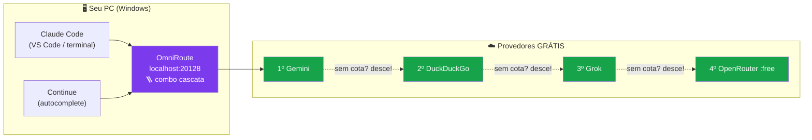

# Guia OmniRoute: sua IA grátis, sua regra 🚀

**Claude Code, VS Code e o que mais você quiser — sem pagar plano, sem depender de um provedor só.**

[](https://github.com/vitorsavicki/guia-omniroute/actions/workflows/ci.yml)
[](https://github.com/vitorsavicki/guia-omniroute/actions/workflows/security.yml)

Guia completo, testado na prática, usando o [OmniRoute](https://github.com/diegosouzapw/OmniRoute) como gateway para
provedores de IA gratuitos — com **cascata anti-cota** (failover automático),
autostart no Windows e segurança desde o dia um.

> Todo o passo a passo foi executado de verdade em um Windows 10, incluindo os
> erros e as correções. Nada aqui é teoria.
>
> **Nível:** iniciante-friendly — se você sabe copiar e colar, você consegue. 💪
> **Tempo total:** ~1h30 no seu ritmo, com pausas para café. ☕

## 🗺️ O que você vai ter no final



Se um provedor estoura a cota grátis, o próximo da fila assume
**sozinho, no mesmo segundo** — você nem percebe.

## 🧰 Antes de começar (10 min)

Só 3 ferramentas. No PowerShell, uma por vez:

```powershell
winget install OpenJS.NodeJS.LTS          # Node.js (precisa 22.22.2+)
winget install Microsoft.VisualStudioCode # VS Code
winget install Git.Git                    # Git
```

**Feche e reabra o PowerShell**, depois confirme:

```powershell
node --version    # esperado: v22.22.2 ou maior
code --version    # qualquer versão recente
git --version     # qualquer versão recente
```

> 💡 Não tem `winget`? Baixe manualmente: [nodejs.org](https://nodejs.org),
> [code.visualstudio.com](https://code.visualstudio.com), [git-scm.com](https://git-scm.com).

## 📚 O guia (siga na ordem!)

| Etapa | Arquivo | ✅ Você terminou quando... |
|---|---|---|
| 1️⃣ Instalação do OmniRoute | [docs/01-instalacao.md](docs/01-instalacao.md) | o health check responde `200` |
| 2️⃣ Provedores gratuitos | [docs/02-provedores.md](docs/02-provedores.md) | 2+ provedores conectados no painel |
| 3️⃣ Claude Code + VS Code | [docs/03-claude-code.md](docs/03-claude-code.md) | `claude -p "oi"` responde |
| 4️⃣ A cascata anti-cota | [docs/04-cascata.md](docs/04-cascata.md) | o teste com `"model":"cascata"` retorna 200 |
| 5️⃣ Autostart no Windows | [docs/05-autostart-e-dicas.md](docs/05-autostart-e-dicas.md) | OmniRoute sobe sozinho após reiniciar |
| 6️⃣ Segurança (obrigatório!) | [docs/06-seguranca.md](docs/06-seguranca.md) | senha trocada + gateway só em 127.0.0.1 |
| 7️⃣ Plugins, extensões e memória | [docs/07-plugins-e-memoria.md](docs/07-plugins-e-memoria.md) | Claude lembra do projeto entre sessões |
| 🆘 Troubleshooting | [docs/08-troubleshooting.md](docs/08-troubleshooting.md) | consulte quando algo falhar |

## ⚡ Scripts prontos

- [`scripts/configurar-claude-env.ps1`](scripts/configurar-claude-env.ps1) — grava as variáveis de ambiente do Claude Code
- [`scripts/iniciar-tudo.bat`](scripts/iniciar-tudo.bat) — sobe o OmniRoute de uma vez (use no shell:startup)

## 🧪 Provedores validados (out/2026)

| Provedor | Cadastro | Velocidade | Observação |
|---|---|---|---|
| **Google Gemini** (AI Studio) | conta Google | ⭐⭐⭐ | `gemini-3.1-flash-lite` = cotão; `3.8-flash` é forte mas cota diária pequena |
| **DuckDuckGo AI** | **nenhum** | ⭐⭐ | zero config; cota anônima reseta em horas |
| **Grok (xAI)** | login social | ⭐⭐⭐ | grok-cli no OmniRoute |
| **OpenRouter** | conta grátis | ⭐⭐ | dezenas de modelos `:free` |
| GitHub Copilot | precisa licença | — | ❌ só funciona com assinatura Copilot |

## 🔒 Segurança

Este repo pratica o que prega: gitleaks no CI, `SECURITY.md`, e um capítulo
inteiro de hardening. **Nunca** commite chaves — todas as chaves do guia usam
placeholders `<...>`.

## 📝 Licença

MIT — use, adapte, compartilhe. Se o guia te ajudou, deixa uma ⭐!
