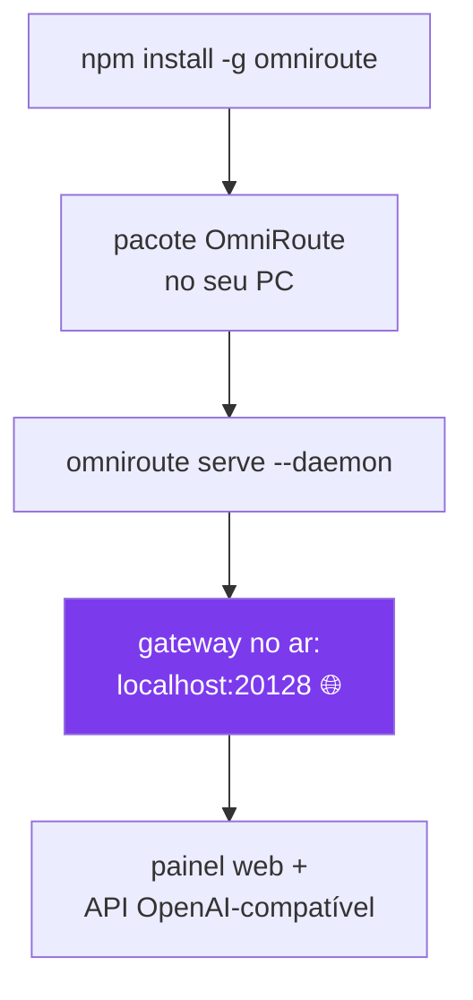

# 1️⃣ Instalação do OmniRoute

## 🧰 Pré-requisitos (se ainda não instalou)

```powershell
winget install OpenJS.NodeJS.LTS          # Node.js (precisa 22.22.2+)
winget install Microsoft.VisualStudioCode # VS Code (recomendado)
winget install Git.Git                    # Git
```

**Feche e reabra o PowerShell** e confirme:

```powershell
node --version    # esperado: v22.22.2 ou maior
```

## Instalação padrão

```powershell
npm install -g omniroute
omniroute serve --daemon --port 20128 --no-open
```

⏳ **Paciência no primeiro start:** o daemon leva ~2 minutos para ficar
saudável (ele sincroniza catálogos na largada). Normal!

Painel: http://localhost:20128 — no primeiro acesso a senha é `CHANGEME`
(**troque já!** veja [06-seguranca.md](06-seguranca.md)).

## ✅ Checkpoint

```powershell
curl.exe -s -o NUL -w "%{http_code}" http://127.0.0.1:20128/api/monitoring/health
# esperado: 200
```

Deu `200`? Prossiga. Timeout? Aguarde 1-2 min e tente de novo.

## 🚨 Cenário real: disco C: quase cheio

Tudo foi testado num PC com 3 GB livres no C:. Solução: instalar em outro drive.

```powershell
# 1. Redirecione o npm global + cache ANTES de instalar
npm config set prefix "E:\dev\npm-global"
npm config set cache  "E:\dev\npm-cache"

# 2. Habilite caminhos longos (evita TAR_ENTRY_ERROR no Windows)
#    Rode como Administrador:
New-ItemProperty -Path "HKLM:\SYSTEM\CurrentControlSet\Control\FileSystem" `
  -Name "LongPathsEnabled" -Value 1 -PropertyType DWORD -Force

# 3. Instale normalmente
npm install -g omniroute
```

### Se o ecossistema Claude insistir em gravar no C:

O Claude Code grava em `~/.claude` e `~/.bun`. Redirecione com **junctions**:

```powershell
# Mova as pastas para o drive grande e crie links de volta
robocopy "C:\Users\SEU_USUARIO\.claude" "E:\dev\claude-home" /E /MOVE
cmd /c mklink /J "C:\Users\SEU_USUARIO\.claude" "E:\dev\claude-home"

robocopy "C:\Users\SEU_USUARIO\.bun" "E:\dev\bun" /E /MOVE
cmd /c mklink /J "C:\Users\SEU_USUARIO\.bun" "E:\dev\bun"
```

## 🎨 O que está acontecendo



Próximo: [02-provedores.md](02-provedores.md)
