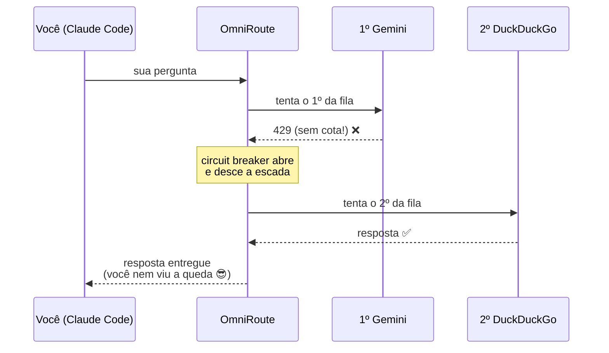

# 4️⃣ A cascata anti-cota 🪜

O segredo para **nunca mais** ver "modelo não responde": um combo OmniRoute
com estratégia `priority`. Se o 1º provedor fica sem cota, a requisição desce
para o próximo **sozinha**.

## Criar a sua

```powershell
omniroute combo create cascata --strategy priority --models `
  "gemini/gemini-3.1-flash-lite,ddgw/gpt-5.4-mini,grok-cli/grok-4.7,openrouter/nvidia/nemotron-3-super-120b-a12b:free"
omniroute combo switch cascata
```

Ajuste a ordem e os modelos para o SEU arsenal (veja
[02-provedores.md](02-provedores.md)). Provedor morto na lista não atrapalha:
o circuit breaker pula ele automaticamente.

## Apontar o Claude Code para a cascata

```powershell
[Environment]::SetEnvironmentVariable("ANTHROPIC_MODEL","cascata","User")
```

(feche e reabra os terminais/VS Code depois)

## Testar a cascata direto no gateway

```powershell
$body = '{"model":"cascata","messages":[{"role":"user","content":"oi"}],"max_tokens":20}'
curl.exe -s -X POST http://127.0.0.1:20128/v1/chat/completions `
  -H "Content-Type: application/json" -H "Authorization: Bearer <SUA_CHAVE_OMNIROUTE>" `
  -d $body
```

## Como a cascata "sente" a cota

- `429` de um provedor → circuit breaker abre com cooldown crescente
  (12s → 24s → 48s → 96s...) e a requisição segue para o próximo
- Isso também explica o **falso "travamento"**: com um único provedor em
  cooldown, o gateway espera o breaker em vez de falhar rápido. Com a
  cascata, sempre há para onde descer.


## 🎨 O desenho da queda



Próximo: [05-autostart-e-dicas.md](05-autostart-e-dicas.md)
